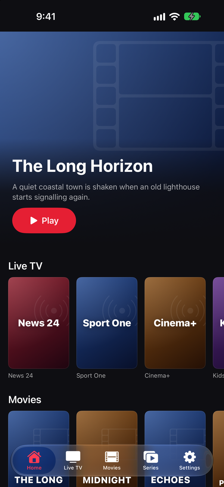
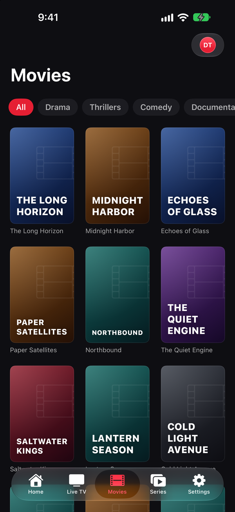
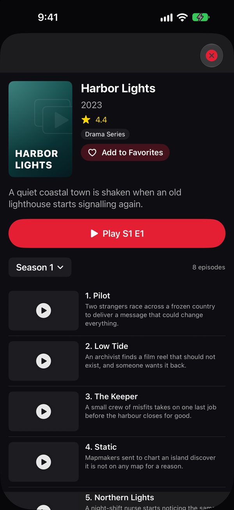
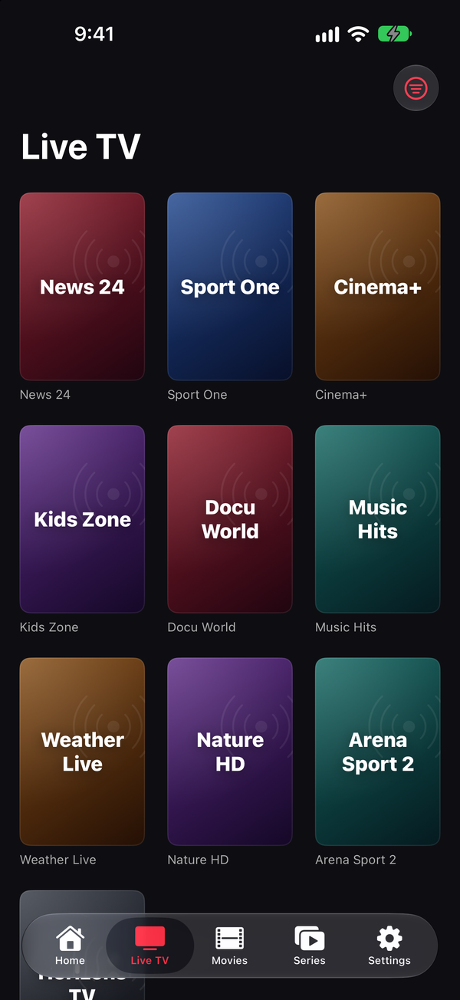
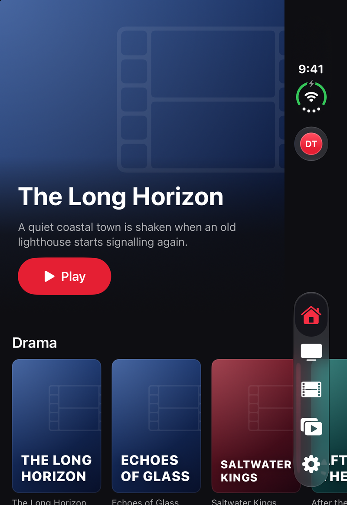
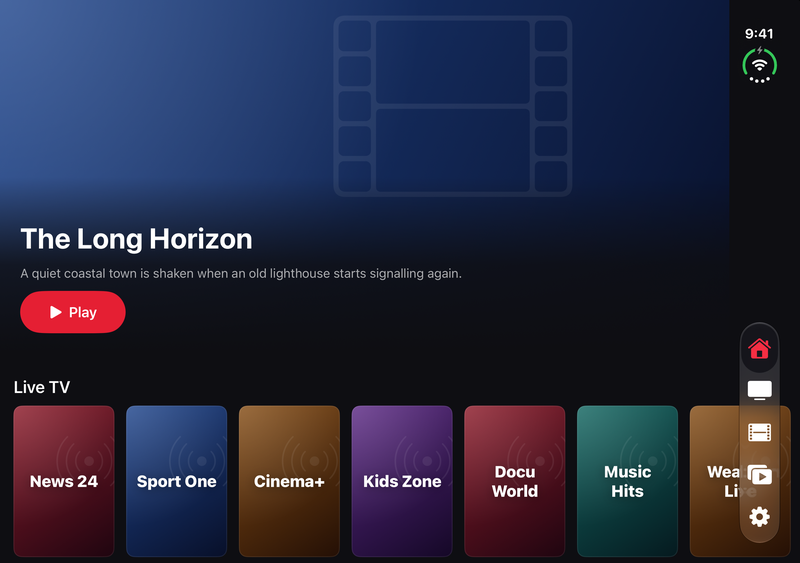
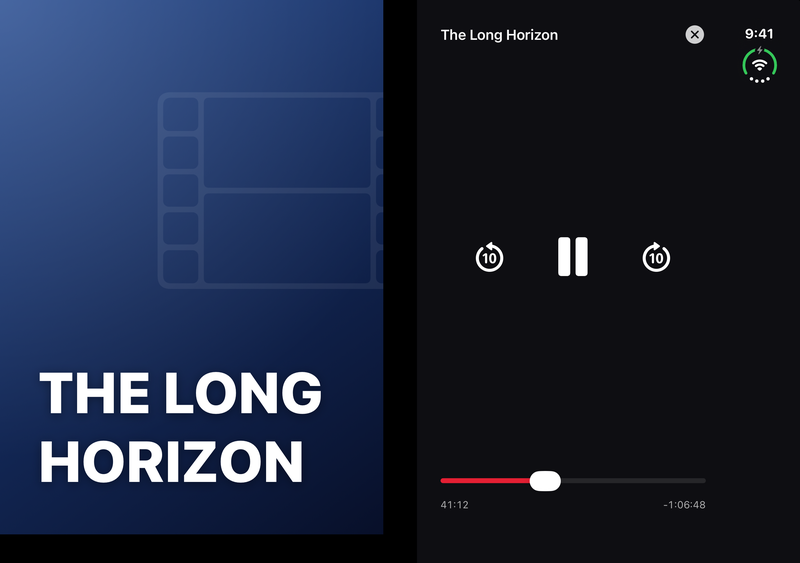
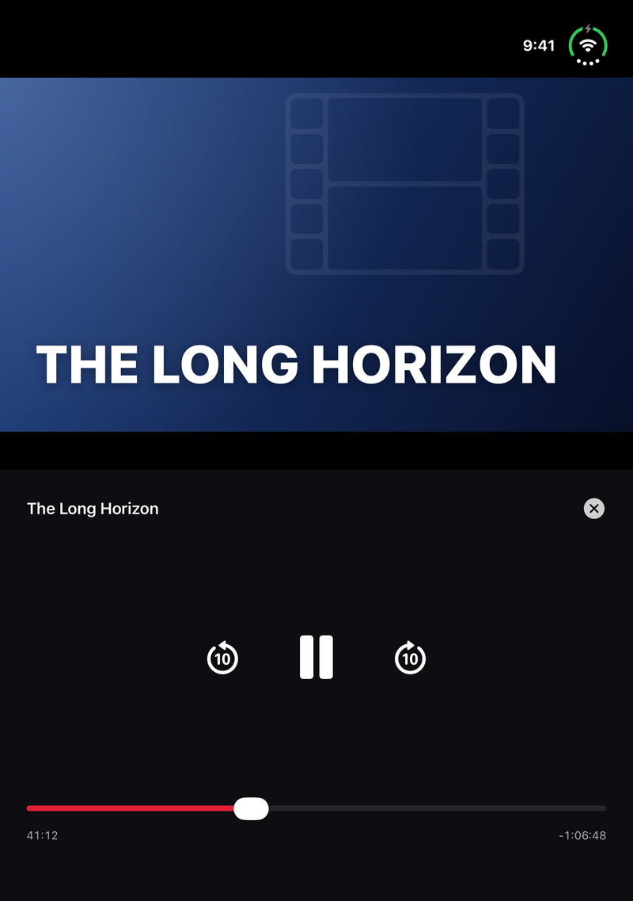
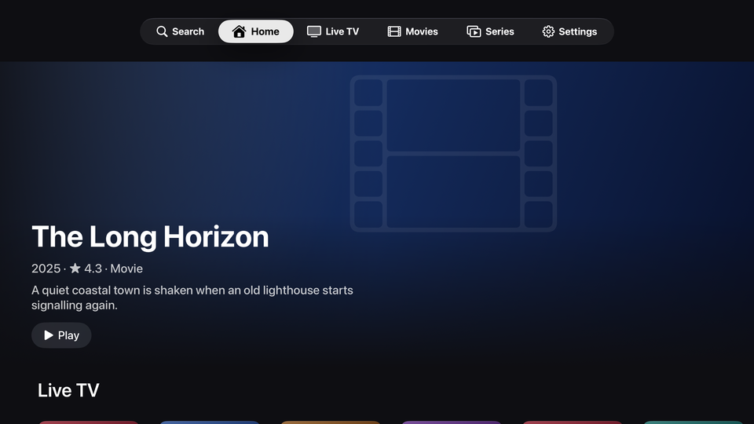
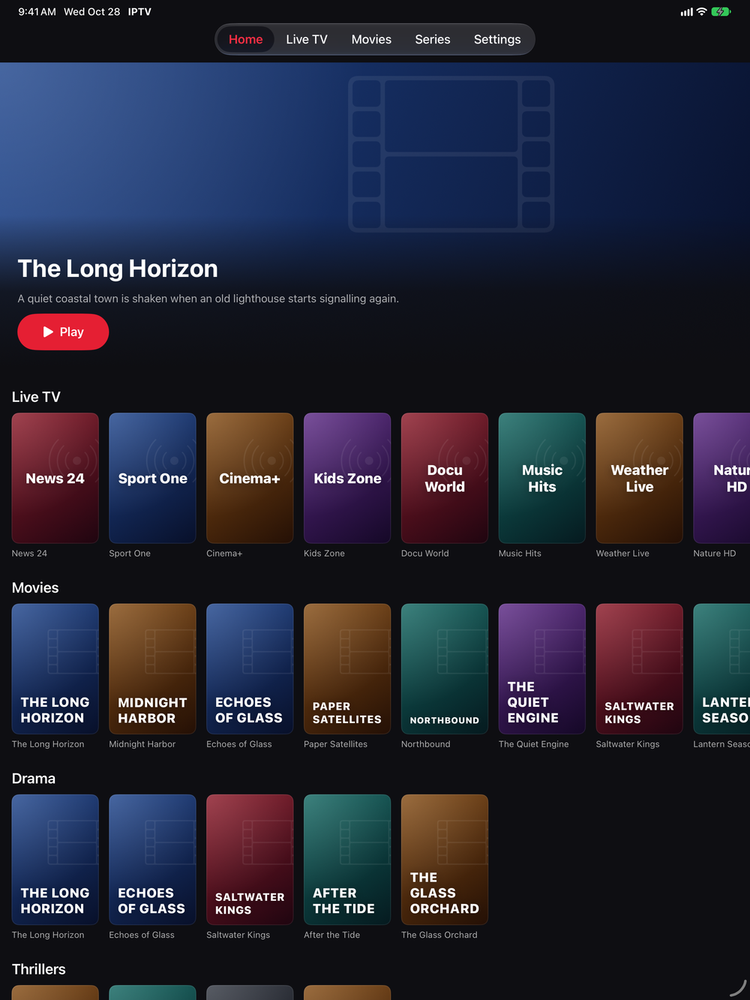

<p align="center"></p>

# AppleIPTV

Netflix-style IPTV client for **iOS, macOS and Apple TV (tvOS)**, built with SwiftUI and AVKit.

Supports two provider protocols:

- **Xtream Codes** — username / password (`player_api.php`)
- **Stalker / Ministra portals** — MAC-address authentication (handshake + `create_link`)

Multiple providers can be configured; switch the active one in Settings.

## Features

- Dark, cinematic home screen: hero banner + horizontal carousels (Live TV, Movies, Series, per-category rows)
- Browse tabs with grid, category filter and search
- Detail view: poster, plot, rating, seasons/episodes for series, short EPG for live channels (Xtream)
- Full-screen playback via AVPlayer (HLS live streams, VOD mp4/mkv), AirPlay enabled
- Provider form with connection test and automatic MAC formatting/validation
- Providers synced across devices via iCloud Key-Value Store (UserDefaults fallback; active provider stays per-device)
- iPhone Duo fold-aware player (iOS 27.1+), on both the system and VLC engines: half-fold the device during playback and the layout follows the fold's reserved division region — laptop/tabletop (horizontal fold): video above, Netflix-style controls (play/pause, ±10 s, scrubber, LIVE badge) below; book (vertical fold): video and controls side by side

## Screenshots

| Home | Movies | Series | Live TV |
| --- | --- | --- | --- |
|  |  |  |  |

**iPhone Duo**: cover screen, inner screen open flat, player half folded as a book and on a table (laptop mode)

| Cover screen | Open flat | Half folded, book | Half folded, laptop |
| --- | --- | --- | --- |
|  |  |  |  |

**Apple TV**



**iPad**



Taken by `scripts/screenshots.sh` from the app's demo mode (made-up channels, films and series, no network) on fresh
simulators, the iPhone Duo folded with [duoctl](https://github.com/skarol/duoctl); the Screenshots workflow takes them
again when the app changes. Full-size App Store copies are in [`appstore/screenshots`](appstore/screenshots).

## Project structure

```
project.yml            # XcodeGen spec — 3 targets: IPTV (iOS), IPTV-macOS, IPTV-tvOS
design/                # Icon renderer (render_icons.py)
scripts/               # Dead-code check, screenshots
Sources/
  App/                 # App entry point, theme
  Models/              # Provider, MediaItem, Episode, EPG, errors
  Clients/             # IPTVClient protocol, XtreamClient, StalkerClient
  Store/               # AppStore (providers + content loading)
  Views/               # Home, Browse, Detail, Player, Settings, components
  Demo/                # Screenshot demo mode (-demo YES -demoScreen …)
```

All three targets share the same `Sources/` tree; platform differences are handled with `#if os(...)` shims.

## Build

Requires Xcode 15+ and [XcodeGen](https://github.com/yonaskolb/XcodeGen):

```sh
brew install xcodegen
xcodegen generate
open AppleIPTV.xcodeproj
```

Pick the scheme for your platform: `IPTV` (iOS), `IPTV-macOS`, or `IPTV-tvOS`.

## Release

Bump `MARKETING_VERSION` in `project.yml`, add its `## x.y.z` section to [CHANGELOG.md](CHANGELOG.md) and push to
`main`: the Release workflow tags `vx.y.z`, publishes a GitHub release with an iOS simulator build and an ad-hoc
signed macOS app, and — with an App Store Connect API key in the `APP_STORE_CONNECT_KEY`, `APP_STORE_CONNECT_KEY_ID`
and `APP_STORE_CONNECT_ISSUER_ID` secrets and the `APPLE_TEAM_ID` variable — uploads the iOS, tvOS and macOS builds
to TestFlight. The build number is the commit count.

## Adding a provider

- **Xtream**: server URL like `http://host:8080`, plus username and password.
- **Stalker**: portal URL like `http://host/stalker_portal` (or ending in `/c`), plus the MAC address registered with the provider (`00:1A:79:…`). The client sends the MAG-style User-Agent and `mac` cookie expected by Ministra portals.

> `NSAllowsArbitraryLoads` is enabled because most IPTV portals are plain HTTP.

## License

MIT — © juju35
